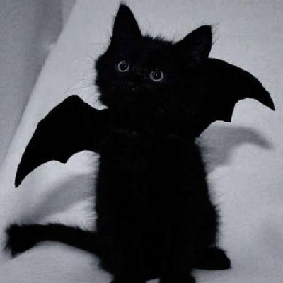

<div align="center">
  
  <br><br>
</div>
<p align="center">
  16 y/o • Lycée ISETA-ECA Chavanod • Haute-Savoie 🇫🇷 • :3
</p>

<p align="center">
  
  
  
  
  
</p>

---

```python
class _0p4n1k:
    age      = 16
    location = "Haute-Savoie, France 🏔️"
    school   = "ISETA-ECA Chavanod (1ère CIEL) 🎓"
    skills   = ["Rust 🦀", "Python / Bytecode 🐍", "Java ☕", "C ⚙️"]
    focus    = [
        "reverse engineering 🔍",
        "binary & bytecode analysis",
        "obfuscation & deobfuscation"
    ]
    learning = ["hardware reversing & embedded systems 🔌⚡"]
```

---

### 🛠️ stack

<div align="center">
  
</div>

---

### 🔬 specialty

<div align="center">
  
  
  
  
  
</div>

---

<details>
<summary>📊 stats</summary>
<br>
<div align="center">
  
  <br><br>
  
</div>
</details>
